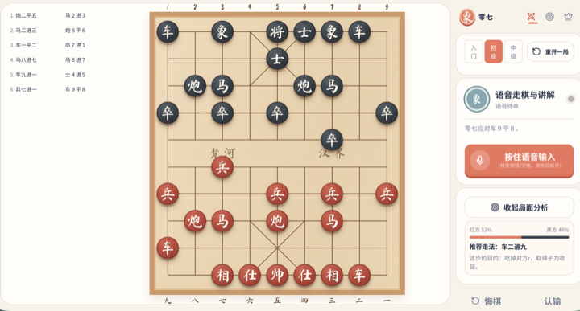
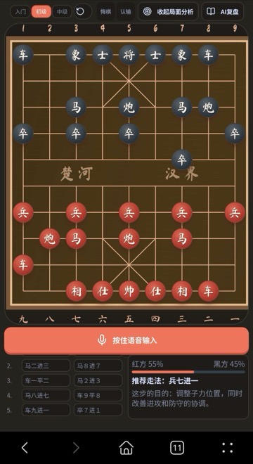

# 零七 ZERO7

[](https://github.com/visualfc/zero7/actions/workflows/ci.yml)
[](https://codecov.io/github/visualfc/zero7)
[](./LICENSE)

零七（ZERO7）是一款中文 AI 语音象棋应用，面向象棋初学者和普通爱好者。应用将本地象棋规则、Pikafish 棋力引擎和灵矽语音能力结合起来，提供人机对战、杀棋训练、残局训练和经典棋局 AI 复盘。

## 棋盘预览

<p align="center">
  
  &nbsp;&nbsp;&nbsp;&nbsp;
  
</p>

## 核心功能

### 人机对战

- 标准 32 子开局和完整中国象棋规则；用户执红，零七执黑。
- Pikafish 入门、初级、中级三档棋力；引擎不可用时降级为基础 AI。
- 支持点击走棋、中文语音走棋、悔棋、认输和重新开局。
- 显示中文棋谱、最近一步路径、吃子动画、将军和终局状态。
- 局面分析显示红黑胜率、推荐走法及走棋目的。
- 切换到其他页面后返回，人机棋盘和棋谱保持不变。
- 将死按绝杀、闷杀和困毙杀分类。

### 杀棋训练

- 使用 Wukong Xiangqi 一步杀至 N 步杀题库。
- 使用杀棋类型和题号双下拉菜单选题。
- 题号按 `1001`、`2001`、`3001`、`4001` 和 `9001` 分组。
- 支持红方先行和黑方先行局面，界面直接显示当前先行方。
- 支持三级提示、重新练习、下一题、点击走棋和语音走棋。
- 用户每个合法走法都由 Pikafish 应对，不依赖固定答案直接判定成功。

### 残局训练

- 使用棋弈江湖残局题库，按车类、马炮、炮类、马类、兵类和仕相分类。
- 各类题号从 `10001`、`20001`、`30001`、`40001`、`50001` 和 `60001` 开始。
- 支持双下拉选题、先行方显示、完整棋谱、走子路径和语音输入。
- Pikafish 引擎讲解可展开或收起；展开后随每一步自动更新。

### AI 复盘与经典棋局

AI 复盘整合在人机对战页底部。进入后暂停人机操作和回合提醒，返回对战时恢复原人机棋局。

- 经典棋库包含 2,000 盘完整大师对局。
- 只导入红黑双方中文姓名均已确认的棋局，不自动音译未确认姓名。
- SQLite 支持按赛事、中文棋手和来源原名搜索；列表按需加载完整棋谱。
- 左侧显示可滚动的完整中文棋谱，右侧显示按顺序排列的全局关键步。
- 支持开局、上一步、下一步、终局和每 5 秒自动播放。
- 自动播放异步朗读每一步中文棋谱。
- 当前局面分析显示红黑胜率、实战着及推测目的；第 3 步起，实战着与引擎首选不同时显示推荐着及目的。
- 全局分析采用 30 秒预算的两阶段流程：快速扫描整盘，再深度复核候选关键步。
- 当前棋局来源没有为全部对局提供可核验赛果，因此暂不显示胜负结果。

### 语音交互

- 灵矽实时语音识别（STT）和语音合成（TTS）。
- 浏览器采集 `16 kHz PCM16` 麦克风音频。
- 人机、训练和残局支持按住按钮或空格说走法，松开后识别。
- 中文棋谱支持常见同音词和标点纠错。
- TTS 与棋局状态异步执行；语音卡住或失败不会阻塞引擎走棋。
- 训练、残局、人机应手和复盘自动播放均朗读实际中文走法。

## 首页与导航

- 首页只保留一套核心入口：人机对战、杀棋训练和残局训练。
- 三个入口在主页、桌面导航和移动端导航中统一使用双剑、靶心和王冠图标。
- “今日三小关”每天从杀棋训练题库稳定随机选择三题，优先覆盖不同训练类型；当天重复进入保持不变。
- 当前隐藏学习成长入口，保留核心棋局功能。

## 数据与系统架构

```text
浏览器 React 应用
  ├─ 象棋规则与中文棋谱
  ├─ 灵矽语音采集与播放
  └─ 人机、训练、残局和 AI 复盘
          ↓ HTTPS / HTTP
本地 Express 桥接服务
  ├─ 灵矽设备凭证和 WebSocket 代理
  ├─ SQLite 题库与经典棋局 API
  └─ Pikafish UCI 子进程
```

分工原则：

- `@weshell/xiangqi.js` 决定合法走法、回合和终局状态。
- Pikafish 负责棋力、应手、局面分析和关键步分析。
- 灵矽负责语音识别与语音合成。
- JSON 是可审计源数据，SQLite 是自动生成的运行时查询数据库。
- 设备凭证只保存在服务端 `.env`，不会进入浏览器代码。

题库和棋谱来源、数量及许可证详见 [题库来源](./docs/puzzle-sources.md) 和 [第三方声明](./THIRD_PARTY_NOTICES.md)。面向用户的操作步骤详见 [使用指南](./docs/user-guide.md)，系统时序和交互约束详见 [设计文档](./docs/design.md)，未来实现按阶段记录在 [路线图](./docs/roadmap.md)。

## 安装与运行

要求 Node.js 22 或兼容版本。

```bash
npm install
cp .env.example .env
```

已绑定灵矽设备时配置：

```dotenv
LINXI_DEVICE_ID=已绑定设备的MAC地址
LINXI_CLIENT_ID=软件客户端的固定UUID
LINXI_USE_OTA=true
```

安装并信任本地 HTTPS 根证书：

```bash
brew install mkcert
mkcert -install
npm run dev
```

`npm run dev` 同时启动：

- Vite 网页服务：`https://localhost:5173/`
- 灵矽、题库和 Pikafish 桥接服务：`http://127.0.0.1:8787/`

手机和电脑连接同一 Wi-Fi 后，可通过终端显示的局域网 HTTPS 地址访问。麦克风需要安全上下文和浏览器授权。

## 安装 Pikafish

Pikafish 二进制和 NNUE 权重不随仓库分发。默认目录：

```text
.local/pikafish/
├── pikafish
├── pikafish.nnue
└── WEIGHTS-LICENSE.txt
```

macOS Apple Silicon：

```bash
chmod +x .local/pikafish/pikafish
```

使用其他路径时配置：

```dotenv
PIKAFISH_PATH=/absolute/path/to/pikafish
PIKAFISH_MODEL=/absolute/path/to/pikafish.nnue
```

检查引擎：

```bash
curl http://127.0.0.1:8787/api/pikafish/status
```

Pikafish 源代码采用 GPL-3.0。NNUE 权重可能带有额外授权条件，请阅读下载包中的协议。

## 常用命令

```bash
npm run dev                 # 启动网页和桥接服务
npm test                    # 运行前端与服务端测试
npm run test:coverage       # 运行覆盖率检查
npm run build               # TypeScript 检查和生产构建
npm run puzzles:import      # 从 JSON 重建 SQLite 题库
npm run puzzles:verify      # 校验题库
```

覆盖率门槛：

- Statements ≥ 90%
- Functions ≥ 90%
- Lines ≥ 90%
- Branches ≥ 80%

## 版本状态与未来路线

当前版本聚焦本地可运行的棋局、训练、语音和复盘闭环。已实现能力、系统约束和数据来源分别记录在本文、[设计文档](./docs/design.md) 与 [题库来源](./docs/puzzle-sources.md) 中。

未来实现分为四个阶段：

1. **稳定性与质量**：补齐异常分支覆盖、浏览器回归、超时取消和资源压缩。
2. **内容与分析增强**：扩充已确认棋局、训练题和可解释的关键步分析。
3. **语音与学习体验**：增强识别纠错、播报设置、错着复盘和无障碍支持。
4. **个人化与跨设备**：评估本地学习记录、数据导入导出和可选同步。

详细目标、完成标准和暂不纳入范围见 [路线图](./docs/roadmap.md)。路线图中的内容属于未来计划，未完成前不会作为现有功能宣传。

## 开源协议

项目源代码采用 [Apache License 2.0](./LICENSE)。灵矽服务、第三方依赖、Pikafish、NNUE 权重和题库遵循各自的服务条款或授权协议。

欢迎提交 Issue、经过验证的训练题、语音纠错样本和代码贡献。
